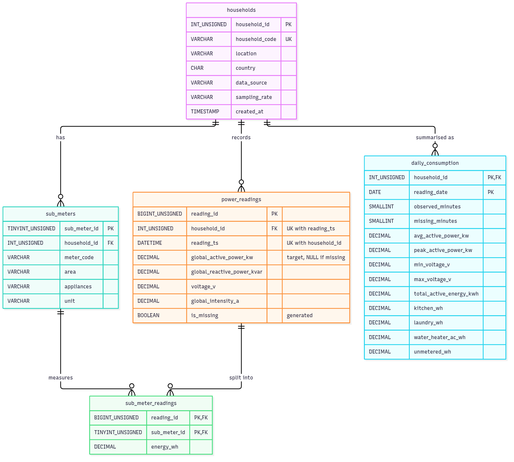

# Task 2 — Database Design (MySQL and MongoDB)

**Dataset:** Individual Household Electric Power Consumption (UCI / Kaggle) — one household in Sceaux, France, measured every minute from **2006-12-16 17:24** to **2010-11-26 21:02** (2,075,259 rows, 25,979 missing minutes).
**Target:** `Global_active_power` (kW). **Other variables:** reactive power, voltage, current intensity and three sub-meters (kitchen, laundry room, water-heater & air-conditioner).

Both databases run in Docker containers and are loaded with the full dataset.

## How to run

Requirements: Docker (with Compose) and [uv](https://docs.astral.sh/uv/). The raw file `household_power_consumption.txt` must be in the repository root.

```bash
docker compose up -d                       # start MySQL 8.4 + MongoDB 8.0
docker compose ps                          # wait until power_mysql is "healthy" (~2 min: it loads the data on first start)
uv run database/mongodb/load_mongo.py      # load MongoDB (~1 min)
./database/run_queries.sh                  # run all queries -> database/results/
```

| Service | Container | Port | Credentials | Database |
|---|---|---|---|---|
| MySQL 8.4 | `power_mysql` | 3306 | `power` / `powerpass` (root: `rootpass`) | `household_power` |
| MongoDB 8.0 | `power_mongo` | 27017 | `root` / `rootpass` (authSource `admin`) | `household_power` |

Open a shell into either database:

```bash
docker compose exec mysql mysql -upower -ppowerpass household_power
docker compose exec mongo mongosh -u root -p rootpass --authenticationDatabase admin household_power
```

`docker compose down` stops the containers and keeps the data; `docker compose down -v` deletes the data, so the next `up` reloads MySQL from scratch.

### Files

| File | Purpose |
|---|---|
| [`docker-compose.yml`](../docker-compose.yml) | MySQL and MongoDB containers, volumes, health checks |
| [`mysql/01_schema.sql`](mysql/01_schema.sql) | SQL schema: 5 tables, keys, constraints, reference data |
| [`mysql/02_load_data.sql`](mysql/02_load_data.sql) | Loads the raw file (`LOAD DATA INFILE`) and fills every table |
| [`mysql/queries.sql`](mysql/queries.sql) | The five SQL queries |
| [`erd.mmd`](erd.mmd) / [`erd.png`](erd.png) | ERD (Mermaid source and rendered image) |
| [`mongodb/load_mongo.py`](mongodb/load_mongo.py) | Creates and loads the three MongoDB collections |
| [`mongodb/sample_documents.json`](mongodb/sample_documents.json) | Sample documents taken from the loaded database |
| [`mongodb/queries.js`](mongodb/queries.js) | The five MongoDB queries |
| [`run_queries.sh`](run_queries.sh) | Runs both query files inside the containers |
| [`results/`](results/) | Query output, exactly as produced by the databases |

---

## Part A — Relational database (MySQL)

### Schema design

The raw file is one wide table (`Date; Time; 7 measurements`). It is normalised into five tables:

| Table | Type | Rows | Primary key | Description |
|---|---|---:|---|---|
| `households` | dimension | 1 | `household_id` | The monitored household (location, source, sampling rate). |
| `sub_meters` | dimension | 3 | `sub_meter_id` | The three sub-metered circuits, with area and appliances. |
| `power_readings` | fact | 2,075,259 | `reading_id` | One row per minute: active power (target), reactive power, voltage, intensity. |
| `sub_meter_readings` | fact | 6,147,840 | (`reading_id`, `sub_meter_id`) | Energy (Wh) per sub-meter per minute. |
| `daily_consumption` | summary | 1,442 | (`household_id`, `reading_date`) | Daily aggregates: energy, average/peak power, voltage range, per-area energy, missing minutes. |

Design decisions:

- **Sub-meters are rows, not columns.** `Sub_metering_1/2/3` are moved into `sub_meter_readings` and described in `sub_meters`, which removes the repeating group (1NF) and lets the schema hold a household with a different number of circuits without changing the table structure.
- **Households are their own table.** The dataset has one household, but every fact table carries `household_id`, so more households can be added without changing the schema.
- **Time is a single `DATETIME` column.** The raw `dd/mm/yyyy` and `hh:mm:ss` strings are combined during loading. `UNIQUE (household_id, reading_ts)` prevents duplicate minutes and is the index used by every time-range query.
- **Missing data is kept as `NULL`.** The 25,979 minutes marked `?` stay in `power_readings` with `NULL` measurements, so the regular one-minute grid stays intact. The stored generated column `is_missing` flags them. They have no rows in `sub_meter_readings`. The database stores the data as recorded; imputation is a modelling choice and is done in the ML pipeline (Task 1).
- **`daily_consumption` is a deliberate summary table.** Forecasting, lag features and moving averages work on daily data. Pre-aggregating 2 million minutes into 1,442 rows makes those queries return in milliseconds. It is filled once by the load script.
- **Constraints:** foreign keys with `ON DELETE CASCADE` from every child to its parent; `CHECK` constraints for non-negative power/energy and a plausible voltage range (150–300 V); `DECIMAL` types so values are stored exactly as in the source file (3 decimals).

### ERD



Relationships: one household has many sub-meters, many minute readings and many daily summaries; each minute reading is split into up to three sub-meter readings; each sub-meter has many readings. `sub_meter_readings` resolves the many-to-many relationship between `power_readings` and `sub_meters`.

### SQL scripts

- [`mysql/01_schema.sql`](mysql/01_schema.sql) — `CREATE TABLE` statements with all keys and constraints, plus the household and sub-meter reference rows.
- [`mysql/02_load_data.sql`](mysql/02_load_data.sql) — loads the file into a staging table with `LOAD DATA INFILE` (converting the dates and turning `?` into `NULL`), unpivots the sub-meters with `INSERT … SELECT … UNION ALL`, builds `daily_consumption` with `GROUP BY DATE(reading_ts)`, then drops the staging table.

Both run automatically from `/docker-entrypoint-initdb.d` the first time the MySQL container starts.

Row counts after loading:

```
+--------------------+---------+
| table              | rows    |
+--------------------+---------+
| households         |       1 |
| sub_meters         |       3 |
| power_readings     | 2075259 |   (25,979 with is_missing = 1)
| sub_meter_readings | 6147840 |   (= 3 x 2,049,280 observed minutes)
| daily_consumption  |    1442 |
+--------------------+---------+
```

---

## Part B — MongoDB

### Collection design

| Collection | Type | Documents | One document = | Key fields |
|---|---|---:|---|---|
| `households` | regular | 1 | a household, with its sub-meters **embedded** as an array | `_id` = household code |
| `readings` | **time-series** (`timeField: ts`, `metaField: meta`, granularity minutes) | 2,075,259 | one minute | `ts`, `meta.household_id` |
| `daily_summaries` | regular | 1,442 | one day, with its **24 hourly aggregates embedded** | unique index `(household_id, date)`, index `(year, month)` |

Design decisions:

- **Embedding vs referencing.** Sub-meters are few, small and always read together with their household, so they are embedded in `households` instead of being a separate collection (the SQL design needs a separate table for this). Readings are referenced through `meta.household_id` instead, because 2 million entries cannot be embedded in one document (16 MB limit).
- **Native time-series collection for `readings`.** MongoDB groups the minute documents into compressed column-wise buckets per `meta` value and time range, and indexes `meta` + `ts` automatically. This is the "bucket pattern" built into the server, so storage is small and time-range queries are fast.
- **Sub-meter values are a nested object** (`sub_metering_wh.kitchen`, `.laundry`, `.water_heater_ac`), so a minute is a single self-contained document — no join is needed, unlike SQL.
- **Flexible schema for missing data.** A missing minute is stored as `{ts, meta, is_missing: true}` with no measurement fields, instead of a row of `NULL`s. Days with no data at all have `observed_minutes: 0` and an empty `hourly` array.
- **`daily_summaries` is pre-aggregated with embedded hourly buckets.** It is built from `readings` by an aggregation pipeline (`$group` by day and hour → `$group` by day with `$push` → `$out`). One read returns a whole day at daily and hourly resolution, which is what daily forecasting and intraday-profile analysis need.

### Sample documents

Taken from the loaded database (full file: [`mongodb/sample_documents.json`](mongodb/sample_documents.json)).

`households`:

```json
{
  "_id": "SCEAUX-01",
  "location": "Sceaux (7 km from Paris)",
  "country": "FR",
  "data_source": "UCI ML Repository / Kaggle — Individual household electric power consumption",
  "sampling_rate": "1 minute",
  "sub_meters": [
    { "code": "kitchen", "raw_column": "Sub_metering_1", "area": "Kitchen",
      "appliances": ["dishwasher", "oven", "microwave"], "unit": "Wh" },
    { "code": "laundry", "raw_column": "Sub_metering_2", "area": "Laundry room",
      "appliances": ["washing machine", "tumble-drier", "refrigerator", "light"], "unit": "Wh" },
    { "code": "water_heater_ac", "raw_column": "Sub_metering_3", "area": "Water heater & AC",
      "appliances": ["electric water-heater", "air-conditioner"], "unit": "Wh" }
  ]
}
```

`readings` — an observed minute and a missing minute:

```json
{
  "ts": { "$date": "2006-12-16T17:24:00Z" },
  "meta": { "household_id": "SCEAUX-01" },
  "is_missing": false,
  "global_active_power_kw": 4.216,
  "global_reactive_power_kvar": 0.418,
  "voltage_v": 234.84,
  "global_intensity_a": 18.4,
  "sub_metering_wh": { "kitchen": 0.0, "laundry": 1.0, "water_heater_ac": 17.0 }
}
```

```json
{
  "ts": { "$date": "2006-12-21T11:23:00Z" },
  "meta": { "household_id": "SCEAUX-01" },
  "is_missing": true
}
```

`daily_summaries` — 24 December 2008 (`hourly` shortened to 2 of its 24 entries):

```json
{
  "household_id": "SCEAUX-01",
  "date": { "$date": "2008-12-24T00:00:00Z" },
  "year": 2008,
  "month": 12,
  "day_of_week": 3,
  "observed_minutes": 1440,
  "missing_minutes": 0,
  "avg_active_power_kw": 0.8817,
  "peak_active_power_kw": 3.878,
  "voltage_v": { "min": 236.94, "max": 248.33 },
  "total_energy_kwh": 21.1606,
  "sub_metering_wh": { "kitchen": 0.0, "laundry": 364.0, "water_heater_ac": 9981.0 },
  "unmetered_wh": 10815.633,
  "hourly": [
    { "hour": 0, "observed_minutes": 60, "avg_active_power_kw": 0.2789, "peak_active_power_kw": 0.354,
      "energy_kwh": 0.2789, "sub_metering_wh": { "kitchen": 0.0, "laundry": 9.0, "water_heater_ac": 0.0 } },
    { "hour": 1, "observed_minutes": 60, "avg_active_power_kw": 0.352, "peak_active_power_kw": 0.63,
      "energy_kwh": 0.352, "sub_metering_wh": { "kitchen": 0.0, "laundry": 44.0, "water_heater_ac": 0.0 } }
  ]
}
```

---

## Part C — Queries and results

All queries were run against the loaded containers with [`run_queries.sh`](run_queries.sh). The result tables below are copied unchanged from [`results/mysql_query_results.txt`](results/mysql_query_results.txt) and [`results/mongodb_query_results.txt`](results/mongodb_query_results.txt).

### MySQL queries

#### Q1. Yearly overview: energy use, peak minute and data completeness per year.

```sql
SELECT h.household_code,
       YEAR(d.reading_date)                                        AS year,
       COUNT(*)                                                    AS days,
       ROUND(SUM(d.total_active_energy_kwh), 1)                    AS total_energy_kwh,
       ROUND(AVG(d.total_active_energy_kwh), 2)                    AS avg_daily_kwh,
       MAX(d.peak_active_power_kw)                                 AS peak_minute_kw,
       SUM(d.missing_minutes)                                      AS missing_minutes,
       ROUND(100 * SUM(d.missing_minutes)
             / SUM(d.observed_minutes + d.missing_minutes), 2)     AS missing_pct
FROM daily_consumption d
JOIN households h ON h.household_id = d.household_id
GROUP BY h.household_code, YEAR(d.reading_date)
ORDER BY year;
```

Result:

```text
+----------------+------+------+------------------+---------------+----------------+-----------------+-------------+
| household_code | year | days | total_energy_kwh | avg_daily_kwh | peak_minute_kw | missing_minutes | missing_pct |
+----------------+------+------+------------------+---------------+----------------+-----------------+-------------+
| SCEAUX-01      | 2006 |   16 |            696.9 |         43.56 |          9.132 |               4 |        0.02 |
| SCEAUX-01      | 2007 |  365 |           9711.8 |         26.68 |         10.670 |            3931 |        0.75 |
| SCEAUX-01      | 2008 |  366 |           9414.9 |         25.72 |         10.348 |             135 |        0.03 |
| SCEAUX-01      | 2009 |  365 |           9371.9 |         25.75 |         11.122 |            4280 |        0.81 |
| SCEAUX-01      | 2010 |  330 |           8088.3 |         25.04 |          9.724 |           17629 |        3.71 |
+----------------+------+------+------------------+---------------+----------------+-----------------+-------------+
5 rows in set
```

**Interpretation.** The three complete years use almost the same energy (9.4–9.7 MWh), with average daily use falling slightly from 26.7 kWh (2007) to 25.8 kWh (2009). The series therefore has a weak downward trend at most. 2006 looks high (43.6 kWh/day) only because it contains just the last 16 days of December, the highest-demand time of year. Data completeness is above 99% in every year, but 2010 has the most missing data (3.7%).

#### Q2. Lag features and 7-day moving average of daily energy (window functions).

```sql
WITH daily AS (
    SELECT reading_date,
           total_active_energy_kwh                                          AS energy_kwh,
           LAG(total_active_energy_kwh, 1) OVER w                           AS lag_1_kwh,
           LAG(total_active_energy_kwh, 7) OVER w                           AS lag_7_kwh,
           AVG(total_active_energy_kwh) OVER (w ROWS BETWEEN 6 PRECEDING AND CURRENT ROW) AS ma_7_kwh
    FROM daily_consumption
    WHERE household_id = 1
    WINDOW w AS (ORDER BY reading_date)
)
SELECT reading_date,
       DAYNAME(reading_date)                                   AS weekday,
       ROUND(energy_kwh, 2)                                    AS energy_kwh,
       ROUND(lag_1_kwh, 2)                                     AS lag_1_kwh,
       ROUND(lag_7_kwh, 2)                                     AS lag_7_kwh,
       ROUND(ma_7_kwh, 2)                                      AS ma_7_kwh,
       ROUND(100 * (energy_kwh - ma_7_kwh) / ma_7_kwh, 1)      AS pct_vs_ma_7
FROM daily
WHERE reading_date BETWEEN '2009-12-14' AND '2010-01-03'
ORDER BY reading_date;
```

Result:

```text
+--------------+-----------+------------+-----------+-----------+----------+-------------+
| reading_date | weekday   | energy_kwh | lag_1_kwh | lag_7_kwh | ma_7_kwh | pct_vs_ma_7 |
+--------------+-----------+------------+-----------+-----------+----------+-------------+
| 2009-12-14   | Monday    |      29.91 |     35.65 |     29.04 |    31.90 |        -6.2 |
| 2009-12-15   | Tuesday   |      32.34 |     29.91 |     33.45 |    31.74 |         1.9 |
| 2009-12-16   | Wednesday |      23.25 |     32.34 |     30.04 |    30.77 |       -24.4 |
| 2009-12-17   | Thursday  |      28.62 |     23.25 |     34.24 |    29.97 |        -4.5 |
| 2009-12-18   | Friday    |      29.08 |     28.62 |     29.74 |    29.87 |        -2.7 |
| 2009-12-19   | Saturday  |      36.74 |     29.08 |     30.27 |    30.80 |        19.3 |
| 2009-12-20   | Sunday    |      19.07 |     36.74 |     35.65 |    28.43 |       -32.9 |
| 2009-12-21   | Monday    |      33.92 |     19.07 |     29.91 |    29.00 |        16.9 |
| 2009-12-22   | Tuesday   |      31.47 |     33.92 |     32.34 |    28.88 |         9.0 |
| 2009-12-23   | Wednesday |      24.25 |     31.47 |     23.25 |    29.02 |       -16.4 |
| 2009-12-24   | Thursday  |      48.43 |     24.25 |     28.62 |    31.85 |        52.1 |
| 2009-12-25   | Friday    |      35.46 |     48.43 |     29.08 |    32.76 |         8.2 |
| 2009-12-26   | Saturday  |      36.39 |     35.46 |     36.74 |    32.71 |        11.3 |
| 2009-12-27   | Sunday    |      36.59 |     36.39 |     19.07 |    35.22 |         3.9 |
| 2009-12-28   | Monday    |      34.90 |     36.59 |     33.92 |    35.36 |        -1.3 |
| 2009-12-29   | Tuesday   |      34.13 |     34.90 |     31.47 |    35.74 |        -4.5 |
| 2009-12-30   | Wednesday |      40.85 |     34.13 |     24.25 |    38.11 |         7.2 |
| 2009-12-31   | Thursday  |      36.86 |     40.85 |     48.43 |    36.46 |         1.1 |
| 2010-01-01   | Friday    |      20.40 |     36.86 |     35.46 |    34.31 |       -40.5 |
| 2010-01-02   | Saturday  |      21.81 |     20.40 |     36.39 |    32.22 |       -32.3 |
| 2010-01-03   | Sunday    |      34.72 |     21.81 |     36.59 |    31.96 |         8.7 |
+--------------+-----------+------------+-----------+-----------+----------+-------------+
21 rows in set
```

**Interpretation.** `lag_1_kwh` and `lag_7_kwh` are the previous day's and previous week's energy, and `ma_7_kwh` is the trailing 7-day mean — the same lag and moving-average features used for forecasting in Task 1. The moving average is smooth (28–38 kWh) while single days vary a lot: Christmas Eve 2009 is 52% above its moving average and 1–2 January 2010 are 32–41% below it (probably the household was away). Days like these are where a lag-only model makes its largest errors.

#### Q3. Where does the energy go at each hour of the day?

```sql
WITH per_minute AS (
    SELECT p.reading_ts,
           p.global_active_power_kw,
           SUM(CASE WHEN m.area = 'Kitchen'           THEN s.energy_wh END) AS kitchen_wh,
           SUM(CASE WHEN m.area = 'Laundry room'      THEN s.energy_wh END) AS laundry_wh,
           SUM(CASE WHEN m.area = 'Water heater & AC' THEN s.energy_wh END) AS heater_ac_wh
    FROM power_readings p
    JOIN sub_meter_readings s ON s.reading_id = p.reading_id
    JOIN sub_meters m         ON m.sub_meter_id = s.sub_meter_id
    WHERE p.household_id = 1
    GROUP BY p.reading_id
)
SELECT HOUR(reading_ts)                                   AS hour_of_day,
       ROUND(AVG(global_active_power_kw), 3)              AS avg_power_kw,
       ROUND(AVG(kitchen_wh), 2)                          AS kitchen_wh_per_min,
       ROUND(AVG(laundry_wh), 2)                          AS laundry_wh_per_min,
       ROUND(AVG(heater_ac_wh), 2)                        AS heater_ac_wh_per_min,
       ROUND(AVG(global_active_power_kw * 1000 / 60
                 - kitchen_wh - laundry_wh - heater_ac_wh), 2) AS unmetered_wh_per_min
FROM per_minute
GROUP BY HOUR(reading_ts)
ORDER BY hour_of_day;
```

Result:

```text
+-------------+--------------+--------------------+--------------------+----------------------+----------------------+
| hour_of_day | avg_power_kw | kitchen_wh_per_min | laundry_wh_per_min | heater_ac_wh_per_min | unmetered_wh_per_min |
+-------------+--------------+--------------------+--------------------+----------------------+----------------------+
|           0 |        0.659 |               0.36 |               0.56 |                 2.97 |                 7.10 |
|           1 |        0.539 |               0.25 |               0.40 |                 2.35 |                 5.99 |
|           2 |        0.481 |               0.15 |               0.35 |                 2.03 |                 5.49 |
|           3 |        0.445 |               0.07 |               0.35 |                 1.69 |                 5.30 |
|           4 |        0.444 |               0.05 |               0.33 |                 1.87 |                 5.15 |
|           5 |        0.454 |               0.04 |               0.32 |                 2.14 |                 5.07 |
|           6 |        0.792 |               0.04 |               0.33 |                 4.24 |                 8.58 |
|           7 |        1.502 |               0.31 |               0.50 |                10.74 |                13.49 |
|           8 |        1.461 |               1.37 |               1.01 |                12.66 |                 9.31 |
|           9 |        1.332 |               1.47 |               1.08 |                12.54 |                 7.10 |
|          10 |        1.261 |               1.13 |               1.54 |                11.45 |                 6.88 |
|          11 |        1.246 |               1.50 |               2.00 |                10.23 |                 7.03 |
|          12 |        1.207 |               1.57 |               2.05 |                 9.10 |                 7.40 |
|          13 |        1.145 |               1.28 |               2.43 |                 8.34 |                 7.03 |
|          14 |        1.083 |               1.47 |               2.48 |                 7.38 |                 6.72 |
|          15 |        0.991 |               1.48 |               2.06 |                 6.18 |                 6.79 |
|          16 |        0.949 |               0.96 |               1.85 |                 5.47 |                 7.53 |
|          17 |        1.055 |               0.71 |               1.93 |                 5.38 |                 9.57 |
|          18 |        1.326 |               1.32 |               1.80 |                 5.76 |                13.23 |
|          19 |        1.733 |               2.61 |               2.11 |                 6.75 |                17.42 |
|          20 |        1.899 |               2.78 |               1.90 |                 8.44 |                18.53 |
|          21 |        1.878 |               2.82 |               1.78 |                 7.62 |                19.07 |
|          22 |        1.413 |               2.23 |               1.17 |                 5.70 |                14.45 |
|          23 |        0.902 |               0.96 |               0.83 |                 4.01 |                 9.24 |
+-------------+--------------+--------------------+--------------------+----------------------+----------------------+
24 rows in set
```

**Interpretation.** At night the house uses about 0.45 kW (fridge, standby devices). The **07:00–09:00 morning peak** comes mostly from the water-heater/AC circuit (10–13 Wh per minute, i.e. 0.6–0.8 kW). The **19:00–21:00 evening peak** (≈1.9 kW) comes mostly from the **unmetered** load (17–19 Wh/min: lighting, electronics, heating) together with the kitchen. Unmetered consumption is the largest share in most hours, so the three sub-meters explain only part of the target.

#### Q4. Data quality: the five longest outages (consecutive missing minutes).

```sql
WITH missing AS (
    SELECT reading_ts,
           TIMESTAMPDIFF(MINUTE, '2006-12-16 00:00:00', reading_ts)
             - ROW_NUMBER() OVER (ORDER BY reading_ts) AS island
    FROM power_readings
    WHERE household_id = 1 AND is_missing
)
SELECT MIN(reading_ts)                 AS outage_start,
       MAX(reading_ts)                 AS outage_end,
       COUNT(*)                        AS missing_minutes,
       ROUND(COUNT(*) / 60, 1)         AS missing_hours
FROM missing
GROUP BY island
ORDER BY missing_minutes DESC
LIMIT 5;
```

Result:

```text
+---------------------+---------------------+-----------------+---------------+
| outage_start        | outage_end          | missing_minutes | missing_hours |
+---------------------+---------------------+-----------------+---------------+
| 2010-08-17 21:02:00 | 2010-08-22 21:27:00 |            7226 |         120.4 |
| 2010-09-25 03:56:00 | 2010-09-28 19:12:00 |            5237 |          87.3 |
| 2007-04-28 00:21:00 | 2007-04-30 14:23:00 |            3723 |          62.1 |
| 2009-06-13 00:30:00 | 2009-06-15 07:34:00 |            3305 |          55.1 |
| 2010-01-12 14:53:00 | 2010-01-14 19:01:00 |            3129 |          52.2 |
+---------------------+---------------------+-----------------+---------------+
5 rows in set
```

**Interpretation.** The longest outages last 2–5 days (52–120 hours), and three of the five are in 2010. Gaps this long cannot be filled reliably by linear interpolation. This confirms the Task 1 decision to interpolate short gaps and to fill long gaps with a seasonal profile.

#### Q5. Peak-demand events: the five highest-power minutes with their sub-meter breakdown.

```sql
SELECT p.reading_ts,
       p.global_active_power_kw                                          AS active_power_kw,
       p.voltage_v,
       p.global_intensity_a                                              AS intensity_a,
       MAX(CASE WHEN s.sub_meter_id = 1 THEN s.energy_wh END)            AS kitchen_wh,
       MAX(CASE WHEN s.sub_meter_id = 2 THEN s.energy_wh END)            AS laundry_wh,
       MAX(CASE WHEN s.sub_meter_id = 3 THEN s.energy_wh END)            AS heater_ac_wh,
       ROUND(p.global_active_power_kw * 1000 / 60 - SUM(s.energy_wh), 2) AS unmetered_wh
FROM (SELECT * FROM power_readings
      WHERE household_id = 1 AND NOT is_missing
      ORDER BY global_active_power_kw DESC
      LIMIT 5) p
JOIN sub_meter_readings s ON s.reading_id = p.reading_id
GROUP BY p.reading_id, p.reading_ts, p.global_active_power_kw, p.voltage_v, p.global_intensity_a
ORDER BY active_power_kw DESC;
```

Result:

```text
+---------------------+-----------------+-----------+-------------+------------+------------+--------------+--------------+
| reading_ts          | active_power_kw | voltage_v | intensity_a | kitchen_wh | laundry_wh | heater_ac_wh | unmetered_wh |
+---------------------+-----------------+-----------+-------------+------------+------------+--------------+--------------+
| 2009-02-22 17:09:00 |          11.122 |   229.780 |      48.400 |     35.000 |     69.000 |       16.000 |        65.37 |
| 2007-03-04 19:34:00 |          10.670 |   230.200 |      46.400 |     37.000 |     69.000 |       16.000 |        55.83 |
| 2007-03-04 19:33:00 |          10.650 |   229.970 |      46.400 |     36.000 |     70.000 |       17.000 |        54.50 |
| 2009-02-22 17:08:00 |          10.536 |   230.240 |      45.800 |     23.000 |     69.000 |       16.000 |        67.60 |
| 2008-11-30 20:19:00 |          10.348 |   231.600 |      44.600 |     36.000 |     71.000 |       16.000 |        49.47 |
+---------------------+-----------------+-----------+-------------+------------+------------+--------------+--------------+
5 rows in set

Bye
```

**Interpretation.** The highest demand (10.3–11.1 kW) happens on Sunday evenings in the cold season (2007-03-04, 2008-11-30, 2009-02-22). At those moments the laundry circuit draws 69–71 Wh/min (≈4.2 kW, washer/dryer), the kitchen 23–37 Wh/min (1.4–2.2 kW, oven), and the unmetered load another 49–68 Wh/min (3.0–4.1 kW). Peaks are caused by several large appliances running at the same time, not by measurement errors, so they should be kept in the data.

### MongoDB queries

#### M1. Minute readings, 2008-12-24 18:00 to 18:10 (find + projection + sort)

```javascript
table(
  "M1. Minute readings, 2008-12-24 18:00 to 18:10 (find + projection + sort)",
  ["ts", "global_active_power_kw", "voltage_v", "kitchen_wh", "laundry_wh", "heater_ac_wh"],
  db.readings.find(
    { "meta.household_id": "SCEAUX-01",
      ts: { $gte: ISODate("2008-12-24T18:00:00Z"), $lt: ISODate("2008-12-24T18:10:00Z") } },
    { _id: 0, ts: 1, global_active_power_kw: 1, voltage_v: 1,
      kitchen_wh: "$sub_metering_wh.kitchen", laundry_wh: "$sub_metering_wh.laundry",
      heater_ac_wh: "$sub_metering_wh.water_heater_ac" }
  ).sort({ ts: 1 }).toArray()
);
```

Result:

```text
+---------------------+------------------------+-----------+------------+------------+--------------+
| ts                  | global_active_power_kw | voltage_v | kitchen_wh | laundry_wh | heater_ac_wh |
+---------------------+------------------------+-----------+------------+------------+--------------+
| 2008-12-24 18:00:00 | 1.472                  | 243.57    | 0          | 0          | 18           |
| 2008-12-24 18:01:00 | 1.472                  | 243.59    | 0          | 0          | 18           |
| 2008-12-24 18:02:00 | 1.472                  | 243.51    | 0          | 0          | 19           |
| 2008-12-24 18:03:00 | 1.468                  | 243.27    | 0          | 0          | 18           |
| 2008-12-24 18:04:00 | 1.476                  | 243.85    | 0          | 0          | 18           |
| 2008-12-24 18:05:00 | 1.48                   | 244.22    | 0          | 0          | 18           |
| 2008-12-24 18:06:00 | 1.474                  | 243.66    | 0          | 0          | 18           |
| 2008-12-24 18:07:00 | 1.454                  | 242       | 0          | 0          | 18           |
| 2008-12-24 18:08:00 | 1.46                   | 242.46    | 0          | 0          | 18           |
| 2008-12-24 18:09:00 | 1.512                  | 242.96    | 0          | 0          | 18           |
+---------------------+------------------------+-----------+------------+------------+--------------+
10 row(s)
```

**Interpretation.** A raw time-range query on the time-series collection. On Christmas Eve at 18:00 the house drew a steady ≈1.47 kW, and most of it was the water-heater (18 Wh/min ≈ 1.08 kW). Voltage stayed near 243 V.

#### M2. Monthly energy use in 2009 from 1-minute readings (aggregate: $match, $group, $dateTrunc)

```javascript
table(
  "M2. Monthly energy use in 2009 from 1-minute readings (aggregate: $match, $group, $dateTrunc)",
  ["month", "minutes", "energy_kwh", "avg_power_kw", "peak_power_kw", "heater_ac_kwh", "heater_ac_share_pct"],
  db.readings.aggregate([
    { $match: { ts: { $gte: ISODate("2009-01-01"), $lt: ISODate("2010-01-01") }, is_missing: false } },
    { $group: {
        _id: { $dateTrunc: { date: "$ts", unit: "month" } },
        minutes: { $sum: 1 },
        energy_kwh: { $sum: { $divide: ["$global_active_power_kw", 60] } },
        avg_power_kw: { $avg: "$global_active_power_kw" },
        peak_power_kw: { $max: "$global_active_power_kw" },
        heater_ac_kwh: { $sum: { $divide: ["$sub_metering_wh.water_heater_ac", 1000] } } } },
    { $sort: { _id: 1 } },
    { $project: {
        _id: 0,
        month: { $dateToString: { date: "$_id", format: "%Y-%m" } },
        minutes: 1,
        energy_kwh: { $round: ["$energy_kwh", 1] },
        avg_power_kw: { $round: ["$avg_power_kw", 3] },
        peak_power_kw: 1,
        heater_ac_kwh: { $round: ["$heater_ac_kwh", 1] },
        heater_ac_share_pct: { $round: [{ $multiply: [{ $divide: ["$heater_ac_kwh", "$energy_kwh"] }, 100] }, 1] } } },
  ]).toArray()
);
```

Result:

```text
+---------+---------+------------+--------------+---------------+---------------+---------------------+
| month   | minutes | energy_kwh | avg_power_kw | peak_power_kw | heater_ac_kwh | heater_ac_share_pct |
+---------+---------+------------+--------------+---------------+---------------+---------------------+
| 2009-01 | 44639   | 1049.2     | 1.41         | 9.59          | 329.6         | 31.4                |
| 2009-02 | 40256   | 837        | 1.248        | 11.122        | 296.2         | 35.4                |
| 2009-03 | 44638   | 912.6      | 1.227        | 8.31          | 328.7         | 36                  |
| 2009-04 | 43198   | 821.3      | 1.141        | 7.972         | 307.8         | 37.5                |
| 2009-05 | 44636   | 753.5      | 1.013        | 7.856         | 311           | 41.3                |
| 2009-06 | 39895   | 559        | 0.841        | 8.76          | 260           | 46.5                |
| 2009-07 | 44636   | 459.8      | 0.618        | 5.928         | 187.9         | 40.9                |
| 2009-08 | 43749   | 484.6      | 0.665        | 7.696         | 192.1         | 39.6                |
| 2009-09 | 43197   | 710.5      | 0.987        | 7.826         | 296.5         | 41.7                |
| 2009-10 | 44639   | 851.5      | 1.144        | 8.708         | 327.5         | 38.5                |
| 2009-11 | 43199   | 917.8      | 1.275        | 9.732         | 335.5         | 36.6                |
| 2009-12 | 44638   | 1015.1     | 1.364        | 8.494         | 383.9         | 37.8                |
+---------+---------+------------+--------------+---------------+---------------+---------------------+
12 row(s)
```

**Interpretation.** Consumption is strongly seasonal: January 2009 (1,049 kWh) uses 2.3 times as much energy as July (460 kWh). The water-heater/AC share is highest in summer (46.5% in June) because heating and lighting loads fall while hot-water use stays about the same. The `minutes` column also shows data quality: June has 39,895 of 43,200 minutes because of the 13–15 June outage (see SQL Q4).

#### M3. Daily energy with lag-1, lag-7 and 7-day moving average, 2009-12-14 to 2010-01-03 ($setWindowFields)

```javascript
table(
  "M3. Daily energy with lag-1, lag-7 and 7-day moving average, 2009-12-14 to 2010-01-03 ($setWindowFields)",
  ["date", "energy_kwh", "lag_1_kwh", "lag_7_kwh", "ma_7_kwh", "pct_vs_ma_7"],
  db.daily_summaries.aggregate([
    { $match: { household_id: "SCEAUX-01" } },
    { $setWindowFields: {
        sortBy: { date: 1 },
        output: {
          lag_1_kwh: { $shift: { output: "$total_energy_kwh", by: -1 } },
          lag_7_kwh: { $shift: { output: "$total_energy_kwh", by: -7 } },
          ma_7_kwh: { $avg: "$total_energy_kwh", window: { documents: [-6, 0] } } } } },
    { $match: { date: { $gte: ISODate("2009-12-14"), $lte: ISODate("2010-01-03") } } },
    { $project: {
        _id: 0,
        date: { $dateToString: { date: "$date", format: "%Y-%m-%d" } },
        energy_kwh: { $round: ["$total_energy_kwh", 2] },
        lag_1_kwh: { $round: ["$lag_1_kwh", 2] },
        lag_7_kwh: { $round: ["$lag_7_kwh", 2] },
        ma_7_kwh: { $round: ["$ma_7_kwh", 2] },
        pct_vs_ma_7: { $round: [{ $multiply: [{ $divide: [{ $subtract: ["$total_energy_kwh", "$ma_7_kwh"] }, "$ma_7_kwh"] }, 100] }, 1] } } },
  ]).toArray()
);
```

Result:

```text
+------------+------------+-----------+-----------+----------+-------------+
| date       | energy_kwh | lag_1_kwh | lag_7_kwh | ma_7_kwh | pct_vs_ma_7 |
+------------+------------+-----------+-----------+----------+-------------+
| 2009-12-14 | 29.91      | 35.65     | 29.04     | 31.9     | -6.2        |
| 2009-12-15 | 32.34      | 29.91     | 33.45     | 31.74    | 1.9         |
| 2009-12-16 | 23.25      | 32.34     | 30.04     | 30.77    | -24.4       |
| 2009-12-17 | 28.62      | 23.25     | 34.24     | 29.97    | -4.5        |
| 2009-12-18 | 29.08      | 28.62     | 29.74     | 29.87    | -2.7        |
| 2009-12-19 | 36.74      | 29.08     | 30.27     | 30.8     | 19.3        |
| 2009-12-20 | 19.07      | 36.74     | 35.65     | 28.43    | -32.9       |
| 2009-12-21 | 33.92      | 19.07     | 29.91     | 29       | 16.9        |
| 2009-12-22 | 31.47      | 33.92     | 32.34     | 28.88    | 9           |
| 2009-12-23 | 24.25      | 31.47     | 23.25     | 29.02    | -16.4       |
| 2009-12-24 | 48.43      | 24.25     | 28.62     | 31.85    | 52.1        |
| 2009-12-25 | 35.46      | 48.43     | 29.08     | 32.76    | 8.2         |
| 2009-12-26 | 36.39      | 35.46     | 36.74     | 32.71    | 11.3        |
| 2009-12-27 | 36.59      | 36.39     | 19.07     | 35.22    | 3.9         |
| 2009-12-28 | 34.9       | 36.59     | 33.92     | 35.36    | -1.3        |
| 2009-12-29 | 34.13      | 34.9      | 31.47     | 35.74    | -4.5        |
| 2009-12-30 | 40.85      | 34.13     | 24.25     | 38.11    | 7.2         |
| 2009-12-31 | 36.86      | 40.85     | 48.43     | 36.46    | 1.1         |
| 2010-01-01 | 20.4       | 36.86     | 35.46     | 34.31    | -40.5       |
| 2010-01-02 | 21.81      | 20.4      | 36.39     | 32.22    | -32.3       |
| 2010-01-03 | 34.72      | 21.81     | 36.59     | 31.96    | 8.7         |
+------------+------------+-----------+-----------+----------+-------------+
21 row(s)
```

**Interpretation.** These are the same lag and moving-average features as SQL Q2, computed with `$setWindowFields` (`$shift` for lags, a `[-6, 0]` document window for the moving average). Every value matches the MySQL result, so both databases hold the same data and give the same answer.

#### M4. Average power by hour of day, weekday vs weekend ($unwind embedded hourly array)

```javascript
table(
  "M4. Average power by hour of day, weekday vs weekend ($unwind embedded hourly array)",
  ["hour", "weekday_kw", "weekend_kw", "weekend_minus_weekday_kw"],
  db.daily_summaries.aggregate([
    { $unwind: "$hourly" },
    { $group: {
        _id: "$hourly.hour",
        weekday_kw: { $avg: { $cond: [{ $lte: ["$day_of_week", 5] }, "$hourly.avg_active_power_kw", "$$REMOVE"] } },
        weekend_kw: { $avg: { $cond: [{ $gte: ["$day_of_week", 6] }, "$hourly.avg_active_power_kw", "$$REMOVE"] } } } },
    { $sort: { _id: 1 } },
    { $project: {
        _id: 0,
        hour: "$_id",
        weekday_kw: { $round: ["$weekday_kw", 3] },
        weekend_kw: { $round: ["$weekend_kw", 3] },
        weekend_minus_weekday_kw: { $round: [{ $subtract: ["$weekend_kw", "$weekday_kw"] }, 3] } } },
  ]).toArray()
);
```

Result:

```text
+------+------------+------------+--------------------------+
| hour | weekday_kw | weekend_kw | weekend_minus_weekday_kw |
+------+------------+------------+--------------------------+
| 0    | 0.569      | 0.889      | 0.32                     |
| 1    | 0.468      | 0.721      | 0.253                    |
| 2    | 0.435      | 0.596      | 0.16                     |
| 3    | 0.412      | 0.529      | 0.117                    |
| 4    | 0.426      | 0.49       | 0.064                    |
| 5    | 0.431      | 0.512      | 0.082                    |
| 6    | 0.875      | 0.579      | -0.296                   |
| 7    | 1.715      | 0.961      | -0.754                   |
| 8    | 1.58       | 1.158      | -0.421                   |
| 9    | 1.367      | 1.241      | -0.126                   |
| 10   | 1.217      | 1.372      | 0.155                    |
| 11   | 1.161      | 1.463      | 0.302                    |
| 12   | 1.109      | 1.457      | 0.348                    |
| 13   | 1.011      | 1.484      | 0.474                    |
| 14   | 0.91       | 1.522      | 0.612                    |
| 15   | 0.842      | 1.369      | 0.526                    |
| 16   | 0.803      | 1.319      | 0.516                    |
| 17   | 0.886      | 1.487      | 0.601                    |
| 18   | 1.143      | 1.792      | 0.649                    |
| 19   | 1.61       | 2.048      | 0.438                    |
| 20   | 1.841      | 2.047      | 0.206                    |
| 21   | 1.854      | 1.931      | 0.077                    |
| 22   | 1.371      | 1.517      | 0.145                    |
| 23   | 0.811      | 1.132      | 0.321                    |
+------+------------+------------+--------------------------+
24 row(s)
```

**Interpretation.** On weekdays the household has a sharp 07:00 peak (1.72 kW) that is much smaller on weekends (0.96 kW), because people get up later. From 11:00 to 19:00 weekend power is 0.3–0.65 kW higher because people are at home. Both day types peak in the evening (19:00–21:00). Hour of day and weekend/weekday are therefore useful features for the forecasting model.

#### M5. Ten days with the most missing minutes (find + projection + sort + limit)

```javascript
table(
  "M5. Ten days with the most missing minutes (find + projection + sort + limit)",
  ["date", "missing_minutes", "observed_minutes", "total_energy_kwh"],
  db.daily_summaries.find(
    { missing_minutes: { $gt: 0 } },
    { _id: 0, date: { $dateToString: { date: "$date", format: "%Y-%m-%d" } },
      missing_minutes: 1, observed_minutes: 1, total_energy_kwh: 1 }
  ).sort({ missing_minutes: -1, date: 1 }).limit(10).toArray()
);
```

Result:

```text
+------------+-----------------+------------------+------------------+
| date       | missing_minutes | observed_minutes | total_energy_kwh |
+------------+-----------------+------------------+------------------+
| 2007-04-29 | 1440            | 0                | NULL             |
| 2009-06-14 | 1440            | 0                | NULL             |
| 2010-01-13 | 1440            | 0                | NULL             |
| 2010-08-18 | 1440            | 0                | NULL             |
| 2010-08-19 | 1440            | 0                | NULL             |
| 2010-08-20 | 1440            | 0                | NULL             |
| 2010-08-21 | 1440            | 0                | NULL             |
| 2010-09-26 | 1440            | 0                | NULL             |
| 2010-09-27 | 1440            | 0                | NULL             |
| 2007-04-28 | 1419            | 21               | 0.379            |
+------------+-----------------+------------------+------------------+
10 row(s)
```

**Interpretation.** Nine days have no data at all, and all of them fall inside the long outages found in SQL Q4 (April 2007, June 2009, January, August and September 2010). Because MongoDB documents do not need a fixed set of fields, these days are stored without the energy fields, so `total_energy_kwh` is `NULL` in the output.

---

## Part D — MySQL vs MongoDB for this dataset

| | MySQL | MongoDB |
|---|---|---|
| Minute data | `power_readings` + `sub_meter_readings` (2 tables, 8.2 M rows, ≈580 MB incl. indexes) | `readings` time-series collection (2.1 M documents, ≈13 MB compressed) |
| Sub-meters | separate rows, joined back with `JOIN` + `CASE` pivot | nested object inside each reading, no join |
| Missing minutes | row with `NULL`s + generated `is_missing` flag | document with only `ts`, `meta`, `is_missing` |
| Daily data | `daily_consumption` table (flat columns) | `daily_summaries` with 24 hourly buckets embedded |
| Lags / moving averages | `LAG()`, `AVG() OVER (ROWS 6 PRECEDING)` | `$setWindowFields` with `$shift` and a document window |
| Strength | Strict schema, foreign keys and `CHECK` constraints guarantee consistency; joins across circuits are flexible | Much smaller storage and simpler documents for append-only sensor data; a whole day is read in one document |

Both databases give identical results for the same calculation (SQL Q2 = MongoDB M3).
